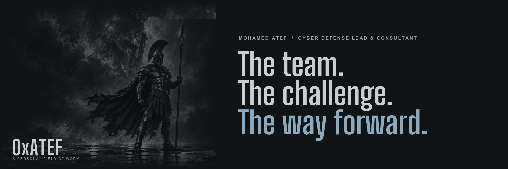

# Mohamed Atef

**0xAtef**  
Cyber Defense Lead & Consultant, Spark Professional Services

I lead people, operations, and technology across SOC, DFIR, compromise assessment, threat detection, and threat intelligence. I still get into unfamiliar problems myself, build the tools the work needs, and spend a growing share of that curiosity on AI.

[Portfolio](https://0xatef.pages.dev/) · [LinkedIn](https://www.linkedin.com/in/0xatef/) · [Experience](https://0xatef.pages.dev/experience/)

## What I lead

I run SOC and DFIR teams for resident and managed services. That means mentoring L1 to L3 analysts, reviewing investigation quality, and keeping triage, escalation, and reporting procedures in working order.

I also design the platforms those teams work from: telemetry, monitoring, integrations, and response workflows. I assess SOC maturity and turn gaps into roadmaps that operations and management can act on.

The technical work stays in my hands. I lead and conduct investigations and compromise assessments. I hunt and write detections with MITRE ATT&CK, including detection-as-code. I build CTI processes so intelligence actually reaches monitoring and investigation. I review security products, configurations, and readiness, including tabletop exercises.

## Selected work

Work I created, with a public case study or public repository. Client names and confidential outcomes stay off this page.

### ThreatOps-Delegate

Personal project I created. Still evolving. Source is private; the public description is the case study.

I set the task. An AI lead coordinates specialist agents through skills and an orchestration layer, and I review the result. When the work is off, I change the system. This is how I organize my own building. It is not a commercial product and it does not run a security operation on its own.

[Public overview](https://0xatef.pages.dev/projects/threatops-delegate/)

### Multi-tenant Elastic architecture

I designed and engineered this. No public repository; details are in the case study.

One Elastic platform for a managed SOC. Client environments shared private subnets, so source IP could not identify who owned an event. I designed tenant-aware ingestion: a dedicated Kafka listener per client, Logstash routing from listener and asset identity, client-specific indices, a quarantine index when ownership is unresolved, and four isolation layers so one tenant cannot read another.

[Case study](https://0xatef.pages.dev/projects/multi-tenant-elastic-architecture/)

### Compromise assessment and Cordon

I created the method and the collector. Source is private; details are in the case study.

Cordon gathers OpenShift forensic evidence with ordinary `oc` commands, without creating debug pods. The same discipline covers proactive assessment and post-incident scoping: hypotheses first, then bounded collection, then conclusions that separate what was found from what could not be tested.

[Case study](https://0xatef.pages.dev/projects/compromise-assessment/)

### Use Case Factory

Detection-as-code pipeline I created around my detections. No public repository; details are in the case study.

I write the Sigma logic. The pipeline checks structure, field mappings, tests, and ATT&CK targets, then builds queries. A person merges the pull request. A use case moves forward only when the fields are mapped and there is evidence the analytic works. ATT&CK tags are not coverage.

[Case study](https://0xatef.pages.dev/projects/attack-informed-detection-coverage/)

### Intelligence pipeline

CTI process I built, including Argus CTI for collection. Argus CTI is public; the wider pipeline is described in the case study.

RSS feeds are labelled, filtered by relevance rules, and published as structured MISP events the SOC can alert and hunt on.

[Case study](https://0xatef.pages.dev/projects/threatops-intelligence-pipeline/) · [Argus CTI (public repository)](https://github.com/0xAtef/Argus-CTI)

### API to QRadar middleware

Integration I built. No public repository; a lab write-up and case study are public.

The source exposed useful security data through an API and had no suitable native QRadar connector. I built retrieval, normalization, LEEF formatting, and syslog delivery as separate stages, with logging when data is bad or missing.

[Case study](https://0xatef.pages.dev/projects/api-to-qradar-middleware/)

## On GitHub

Public original repositories:

- [Argus-CTI](https://github.com/0xAtef/Argus-CTI), the collection tool in the intelligence pipeline
- This profile

Most of the other engineering sits in private repositories, so the portfolio case studies are the public record.

This account also has public forks of other people's repositories. Those forks are not my original work, and I am not listing them as projects I created. I did not find public pull requests from this account into other people's repositories to cite as contributions.

## Tools I work with

This is a working set from the platforms I design and operate. It is not a certification list, and it does not mean equal depth in every product.

Defense platforms: IBM QRadar, Elastic Stack, MISP, TheHive and Cortex.

Automation and integration: Python, REST APIs, n8n, syslog, GitHub Actions.

Also used in the work above: Kafka, Logstash, Sigma, Velociraptor, OpenShift.

## Writing

Notes I wrote, on the current site:

- [Argus CTI: RSS threat-feed pipeline for MISP](https://0xatef.pages.dev/writing/argus-cti/), 26 Apr 2025
- [MISP deployment](https://0xatef.pages.dev/writing/misp-deployment/), 24 Apr 2025
- [API to QRadar through syslog middleware](https://0xatef.pages.dev/writing/api-to-qradar/), 7 Sep 2024

[All writing](https://0xatef.pages.dev/writing/)

## Credentials

Training I bring into the work. Certificates and dates are on the [credentials page](https://0xatef.pages.dev/credentials/).

- Seven MAD20 certificates: ATT&CK fundamentals, SOC assessment, threat hunting and detection engineering, cyber threat intelligence, adversary emulation, purple teaming, and access token detection engineering
- INE Certified Threat Hunting Professional (eCTHPv2)
- Group-IB Threat Intelligence Analyst
- Group-IB Cyber Investigator
- Windows Forensics with Belkasoft

This work started in a 24/7 SOC in 2021. I now lead the SOC and DFIR teams at Spark Professional Services, and I stay in the investigations, platforms, and tooling. [Full timeline](https://0xatef.pages.dev/experience/)

## Contact

Cyber defense leadership, architecture, investigations, or something worth building:

**[Portfolio](https://0xatef.pages.dev/)** · **[LinkedIn](https://www.linkedin.com/in/0xatef/)**

Open to Cyber Defense Manager and Architect roles.
