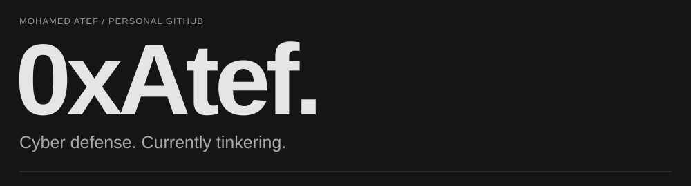
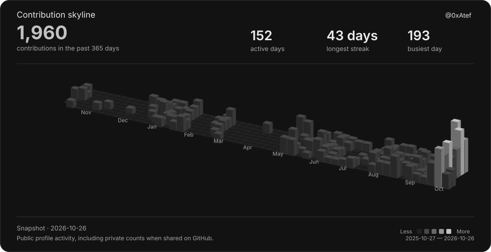
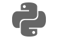
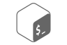
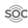

<picture>
  <source media="(max-width: 600px)" srcset="assets/profile-header-mobile.svg" />
  
</picture>

I'm Mohamed. I work in cyber defense and spend a lot of time building tools and experimenting with AI agents.

<picture>
  <source media="(max-width: 600px)" srcset="assets/contribution-skyline-mobile.svg" />
  
</picture>

## Currently playing with

| Cordon (Beta) |
| :--- |
| An offline OpenShift evidence collector I built for investigations and compromise assessments. It produces UAC-style output, with IR, CS, and DF collection levels. |
| **Next:** Improve performance; built-in suspicious-activity checks are a later goal. |

| UCF (In progress) |
| :--- |
| My use-case factory for turning Sigma rules into tested detections. I'm building it around detection-as-code to make producing and validating use cases easier in my own work. |

| AIUCF (In progress) |
| :--- |
| Extending UCF to start with a detection handoff from CTI Bot, then move into Sigma and the detection pipeline. |

| Yami (In development) |
| :--- |
| A DFIR workbench with an editor-style workspace, parsers, a timeline viewer, and pattern-matching rules. I'm building it to become the place I use for analysis and investigations. |

| ThreatOps Delegate (Beta) |
| :--- |
| Cyber defense skills that let an LLM lead coordinate specialist AI analysts while I manage and review the cases. Built to help with parallel investigations. |
| **Next:** Improve accuracy, add runbooks, and reduce running costs. |

## Tools I reach for

<table width="100%">
<tbody>
<tr>
<td width="130" valign="middle">Coding, development &amp; infrastructure</td>
<td><kbd> Python</kbd> &nbsp; <kbd> Bash</kbd> &nbsp; <kbd> PowerShell</kbd> &nbsp; <kbd> Git</kbd> &nbsp; <kbd> GitHub</kbd> &nbsp; <kbd> Kafka</kbd> &nbsp; <kbd> Docker</kbd></td>
</tr>
<tr>
<td width="130" valign="middle">Threat intelligence</td>
<td><kbd> MISP</kbd> &nbsp; <kbd> Group-IB TI</kbd> &nbsp; <kbd> Google Threat Intelligence</kbd> &nbsp; <kbd> SOCRadar</kbd> &nbsp; <kbd> ThreatQ</kbd> &nbsp; <kbd> CTM360</kbd></td>
</tr>
<tr>
<td width="130" valign="middle">SIEM</td>
<td><kbd> Elastic</kbd> &nbsp; <kbd> Splunk</kbd> &nbsp; <kbd> QRadar</kbd> &nbsp; <kbd> FortiSIEM</kbd> &nbsp; <kbd> Wazuh</kbd></td>
</tr>
<tr>
<td width="130" valign="middle">SOAR</td>
<td><kbd> TheHive</kbd> &nbsp; <kbd> FortiSOAR</kbd> &nbsp; <kbd> IBM Resilient</kbd></td>
</tr>
<tr>
<td width="130" valign="middle">EDR / NDR / XDR</td>
<td><kbd> Fidelis</kbd> &nbsp; <kbd> Trellix</kbd> &nbsp; <kbd> Group-IB XDR / NDR</kbd> &nbsp; <kbd> QRadar QNI</kbd></td>
</tr>
<tr>
<td width="130" valign="middle">DFIR</td>
<td><kbd> Velociraptor</kbd> &nbsp; <kbd> KAPE</kbd> &nbsp; <kbd> UAC</kbd></td>
</tr>
<tr>
<td width="130" valign="middle">Detection</td>
<td><kbd> Sigma</kbd> &nbsp; <kbd> RSigma</kbd></td>
</tr>
<tr>
<td width="130" valign="middle">Automation</td>
<td><kbd> n8n</kbd> &nbsp; <kbd> Shuffle</kbd></td>
</tr>
<tr>
<td width="130" valign="middle">C2 &amp; BAS</td>
<td><kbd> Covenant</kbd> &nbsp; <kbd> Havoc</kbd> &nbsp; <kbd> Caldera</kbd></td>
</tr>
</tbody>
</table>

## Skills & certificates

My work covers SOC and DFIR, threat hunting, detection engineering, CTI automation, and security architecture.

I work with MITRE ATT&CK, Cyber Kill Chain, NIST CSF, and PCI DSS.

- eLearnSecurity Certified Threat Hunting Professional (eCTHPv2)
- Group-IB Threat Intelligence Analyst
- Group-IB Cyber Investigator
- Belkasoft Windows Forensics
- Certified Cybersecurity Educator Professional (CCEP)
- Certified Threat Hunting and Incident Response I (CTHIRI)
- Certified Threat Intelligence & Governance Analyst (CTIGA)
- MAD20 MITRE ATT&CK Defender: Fundamentals
- MAD20 MITRE ATT&CK Defender: SOC Assessment
- MAD20 MITRE ATT&CK Defender: Threat Hunting & Detection Engineering
- MAD20 MITRE ATT&CK Defender: Cyber Threat Intelligence (CTI)
- MAD20 MITRE ATT&CK Defender: Adversary Emulation
- MAD20 MITRE ATT&CK Defender: Purple Teaming
- MAD20 MITRE ATT&CK Defender: Access Token Manipulation

